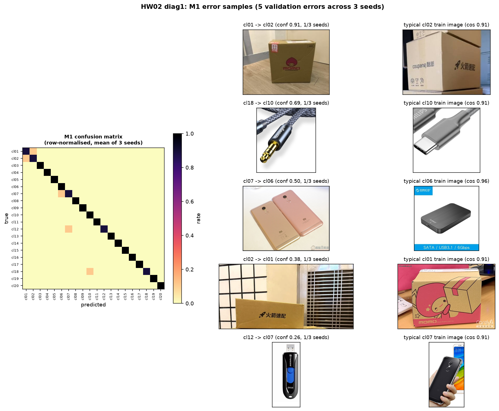
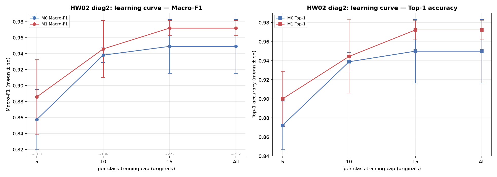
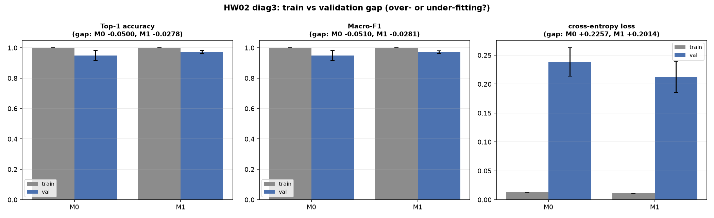
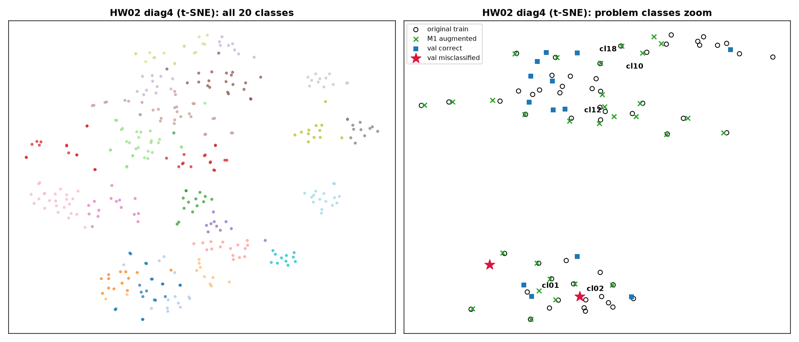
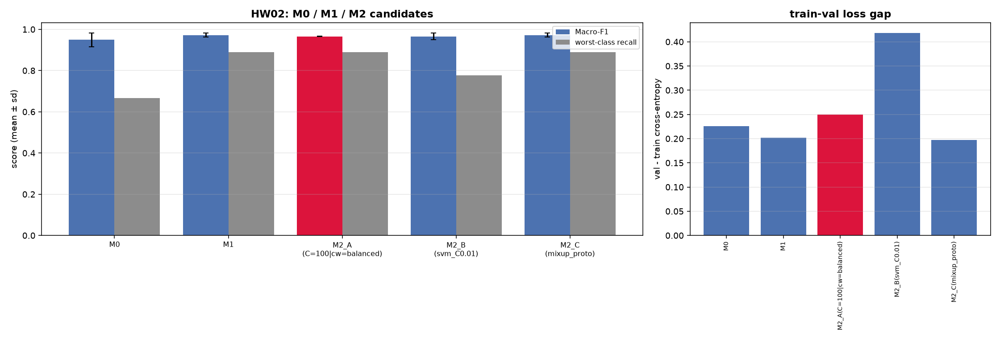

# 電腦視覺期中專案：第二階段（問題診斷、假設提案與 M2 實作）

**組員分工**

| 成員 | 負責範圍 |
|------|----------|
| 楊家筌 | 診斷實驗設計、M2 實作、報告撰寫 |
| 蔡佾宸 | 資料分析、消融實驗、報告撰寫 |

> 本報告所有數字皆為 3 組取樣設定（seed = 42, 420, 4200）的 **Mean ± Std**。三組 seed 的 ±1 std 區間不足以支撐統計推論，因此全文一律以「**區間是否重疊**」與「**抽樣變異（std）是否收斂**」描述差異，不採用推論性（significance）措辭。本階段全程仍**未使用任何生成模型**。

## 第一章　研究問題陳述與 M1 瓶頸回顧

### 1.1 模型演進關係

本專案維持單一命名鏈：**M0 → M1 → M2 → M3**。三者共用同一條特徵管線，差異只在「餵入分類器的訓練資料」與「分類器本身」：

- **M0（基準線）**：`torchvision.models.resnet18(weights=IMAGENET1K_V1)` 全部凍結，`fc` 換成 `nn.Identity` 輸出 512 維特徵；分類器為 `LogisticRegression(solver='lbfgs', C=1.0)`，只用原始訓練集（每組設定 232 張）。
- **M1（＋針對性像素擴增）**：在 M0 的幾何（`direct + bilinear`）與正規化之上，僅對 5 個弱勢類別（cl01、cl06、cl07、cl12、cl18）各追加一份 `mild 2x` 擴增副本，有效訓練量 232 → 289 張；其餘 15 類完全不動。
- **M2（本階段）**：針對第二、三章診斷出的病灶，改動分類器「前半段」（特徵尺度與正規化強度）或「後半段」（分類器家族、特徵空間擴增），並保留 Logistic Regression 作為對照。

### 1.2 M1 留下的兩個未解病灶

第一階段以三項指標（Top-1 `0.9722 ± 0.0096`、Macro-F1 `0.9719 ± 0.0095`、最差類別 Recall `0.8889`）交付 M1，但留下兩個說不通的現象：

**病灶一：投入擴增預算，Recall 卻毫無改善。** cl01 與 cl12 是 M1 的擴增目標，但兩者的 Recall 相對 M0 的差量 Δ = **+0.000**，而同批目標中 cl06、cl07 各 +0.111、cl18 +0.222。對照組的存在排除了「擴增一點用都沒有」的解釋——擴增對 cl18 明顯有效，對 cl01/cl12 卻完全無效。這代表 cl01/cl12 的問題**不是訓練樣本不足**（否則補樣本應有效），而更可能是**類別邊界在特徵空間中重疊**：當某一張驗證影像的最近鄰本來就是別類的樣本時，增加再多「本類正樣本」也無法把它拉回，因為它與本類原型的距離大於它與鄰類原型的距離。

**病灶二：cl18 的穩定漏判。** 在 M0 下，cl18 的 Recall 固定為 `0.667 ± 0.000`（三 seed 完全一致），是唯一「低於 1.000 且零變動」的類別，且三個 seed 的誤判對象都是 cl10。這種**跨 seed 可重現**的錯誤不是抽樣不幸，而是系統性的類別邊界問題；M1 把它拉升到 `0.889 ± 0.192`，是最大改善，但並未根除（詳見 2.1）。

### 1.3 為什麼「每類只有 3 張驗證」放大了這一切

本階段最重要的量測限制是：**每個 seed、每個類別只有 3 張驗證影像**。這造成一個「離散步長」效應。per-class recall 的分母只有 3，所以任何一類的 Recall 只能落在 **{0, ⅓, ⅔, 1}** 四個值上；模型在特徵空間裡「挪動一點決策邊界」，只要沒能剛好翻轉某一張驗證影像的預測，指標就**完全不會動**。這有兩個直接後果：

1. **掩蓋微小變化**：一個只在邊界上微調、把 margin 擴大卻未跨過翻轉門檻的改良，會被離散步長吞掉，在數字上顯示為「毫無效果」。第三章的 Variant A 就是典型受害者——它把抽樣變異壓到近乎為零，卻因翻轉數不變而看不出增益。
2. **區間被撐大**：單一 seed 內 ±1 std 就達 0.192；三 seed 平均後，任何兩個模型的 ±1 std 區間幾乎必然重疊。**因此本階段的正確結論形式是「本實驗無法排除差異來自抽樣變異」，而非「A 優於 B」。** 我們唯一能誠實倚賴的「穩定訊號」，是**跨 seed 完全重現**的現象（如 M0 的 cl18→cl10）與**std 的系統性收斂**。

## 第二章　M1 四大診斷證據與深度病灶分析

### 2.1 診斷一：錯誤樣本與混淆矩陣（圖一）

**圖一**：左為 M1 的列正規化混淆矩陣（三 seed 平均），中為各誤判對的代表驗證影像與模型信心度，右為被誤判類別中最接近其原型的一張訓練影像。

M1 在三個 seed、共 180 張驗證影像中，**總計只犯 5 次錯**（seed 42：2 次、seed 420：1 次、seed 4200：2 次）。這 5 次錯依信心度排序為：

| 誤判對 | 出現 seed | 信心度 | 特徵 |
|--------|-----------|--------|------|
| cl01 → cl02 | 42 | 0.906 | 唯一高信心錯誤，且反向 cl02→cl01 亦在**同一 seed** 出現 |
| cl18 → cl10 | 420 | 0.693 | 病灶二對象，但只在 1/3 seed |
| cl07 → cl06 | 4200 | 0.498 | 低信心，接近隨機 |
| cl02 → cl01 | 42 | 0.385 | 與 cl01→cl02 互為反向 |
| cl12 → cl07 | 4200 | 0.262 | 信心最低 |

（圖一採用全部 5 對；原先僅印出最穩定的 1 對，已修正為完整列出，以符合「實際把錯誤樣本印出來看」的要求。）

**關鍵發現：在 M1 之下，沒有任何誤判對是跨 seed 穩定的。** 五對全部只出現在單一 seed（1/3），沒有一對出現在 2 或 3 個 seed。這與 M0 的 cl18→cl10「三 seed 完全一致」形成強烈對比——換句話說，**M1 的像素擴增改變了決策邊界的細節位置，使原本穩定的 cl18→cl10 在 2/3 的 seed 中消失**，殘餘錯誤則散落到不同的、與抽樣高度相關的影像上。

至於「錯判樣本長什麼樣子」，圖一中可讀出兩條線索：（一）cl01→cl02 的範例是被模型以 0.906 的**高信心**判錯，代表該影像在 512 維特徵中**確實落在 cl02 的原型附近**，不是「勉強猜錯」；（二）cl01/cl02 這一對在**同一個 seed 內雙向互錯**，這是「兩類原型過近、決策邊界夾在兩群之間」的幾何特徵。cl18→cl10、cl10↔cl12 的方向性錯誤則在診斷四以原型距離得到量化佐證。

### 2.2 診斷二：學習曲線（圖二）

**圖二**：M0 與 M1 的 Macro-F1（左）與 Top-1（右）隨「每類真實影像上限」變化的曲線，誤差棒為三 seed 的 ±1 std；橫軸標籤下方灰字為對應的有效訓練張數。

> 實驗設計說明：作業範例建議取每類 5、10、20 張。由於本資料集每類真實訓練數僅 7–21 張，`k=20` 對多數類別幾乎等同於「全部」，無法製造出「未飽和 → 飽和」的對比，因此我們改用 **5、10、15、All** 四點，讓飽和點有機會在曲線中段浮現。

| 每類上限 | 5 | 10 | 15 | All |
|----------|---|----|----|-----|
| M0 Macro-F1 | 0.8575 ± 0.0377 | 0.9381 ± 0.0091 | 0.9490 ± 0.0338 | 0.9490 ± 0.0338 |
| M1 Macro-F1 | 0.8858 ± 0.0468 | 0.9458 ± 0.0357 | 0.9719 ± 0.0095 | 0.9719 ± 0.0095 |
| M0 Top-1 | 0.8722 ± 0.0255 | 0.9389 ± 0.0096 | 0.9500 ± 0.0333 | 0.9500 ± 0.0333 |
| M1 Top-1 | 0.9000 ± 0.0289 | 0.9444 ± 0.0385 | 0.9722 ± 0.0096 | 0.9722 ± 0.0096 |
| 有效訓練張數（M0/M1） | 100 / 125 | 186 / 232 | 222 / 279 | 232 / 289 |

**判讀：M1 的瓶頸是「已飽和」，不是「還沒餵飽」。** 從 k=5 到 k=10，M1 的 Macro-F1 從 0.8858 躍升到 0.9458（斜率 +0.012/張），這是資料量還在起作用的區段；但從 **k=15 到 All，曲線完全平坦**（0.9719 → 0.9719），且有效訓練張數仍增加 10 張卻換不到任何增益。這條曲線在 k=15 就**打平**，明確回答了作業的關鍵問題：**繼續餵更多同分布的真實樣本不會再改善 M1**，真正的天花板不是資料量，而是「線性分類器在凍結特徵空間中能劃出的決策邊界」。這直接排除「加大擴增倍率」作為有效方向——第一階段的 1×–16× 掃描本就在雜訊帶內呈平坦，即為此結論的獨立佐證。

值得注意的次要現象：M1 在 k=5 的點估計（0.8858）高於 M0（0.8575），且 M1 曲線較早打平。這與 1.3 的離散步長一致——擴增的好處在**低資料區間**最能顯現，因為此時決策邊界尚未被任何一類的樣本數主導。

### 2.3 診斷三：訓練／驗證差距（圖三）

**圖三**：M0 與 M1 在訓練集與驗證集上的 Top-1、Macro-F1 與 cross-entropy loss。差距定義為「驗證 − 訓練」。

| 指標 | M0 訓練 | M0 驗證 | M0 差距 | M1 訓練 | M1 驗證 | M1 差距 |
|------|---------|---------|---------|---------|---------|---------|
| Top-1 Acc | 1.0000 ± 0.0000 | 0.9500 ± 0.0333 | −0.0500 | 1.0000 ± 0.0000 | 0.9722 ± 0.0096 | −0.0278 |
| Macro-F1 | 1.0000 ± 0.0000 | 0.9490 ± 0.0338 | −0.0510 | 1.0000 ± 0.0000 | 0.9719 ± 0.0095 | −0.0281 |
| Cross-Entropy | 0.0127 ± 0.0001 | 0.2384 ± 0.0244 | +0.2257 | 0.0111 ± 0.0001 | 0.2125 ± 0.0270 | +0.2014 |

**判讀：這是「零訓練誤差的良性過擬合」，而且過擬合的程度不足以解釋天花板。** 因果鏈如下：凍結的 512 維特徵在 232 個樣本、20 類下**線性可分**，所以 Logistic Regression 在訓練集上把誤差壓到**精確的 0.0000（Accuracy=1.0，loss 僅 0.011–0.013）**；因為訓練誤差已經到底、不可能再低，M0→M1 的差距縮小（−0.050 → −0.028）只能來自**驗證側的改善**，而不是訓練側。M1 的驗證 loss 比 M0 低（0.2125 vs 0.2384），訓練 loss 幾乎相同，所以 loss gap 由 +0.2257 縮到 +0.2014。

然而**關鍵在於量級**：訓練 Accuracy 已鎖死在 1.0，代表「再多訓練資料、再怎麼調邊界，訓練側都不會動」，能改變的只有驗證側那 2.8%–5% 的差距。這說明**模型的瓶頸不在訓練誤差（它已經為零），而在這 2.8%–5% 的泛化差距與其背後的特徵幾何**。同時，loss 的絕對值仍高（訓練 0.011 vs 驗證 0.213，差近 20 倍），代表模型對驗證樣本的**信心校準**很差——這正是 feature scale 與正則化耦合的可疑之處，構成假設 H1 的動機（見第三章）。

### 2.4 診斷四：特徵空間分布與原型距離（圖四）

**圖四**：ResNet-18 凍結特徵的 t-SNE 嵌入（L2 正規化後、perplexity=30）。左為 20 類全貌；右為 5 個問題類別的放大，圈號為原始訓練樣本、綠色叉為 M1 擴增樣本、藍方為分類正確的驗證樣本、紅色星為被 M1 分類錯誤的驗證樣本。點數：原始訓練 232、擴增 57、驗證正確 58、驗證錯誤 2（共 349 點）。

> 誠實揭露：本環境**未安裝 UMAP**，診斷四以 **t-SNE** 呈現二維視覺化。程式已設計為「偵測到 UMAP 才畫第二列」，因此本報告只有 t-SNE 面板；所有定量統計（原型餘弦距離、類內方差）皆對全部 20 類計算，不依賴降維方法，屬 seed 穩定量。

比降維圖更硬的證據是**類別原型的餘弦距離**（1 − cos，0 表示方向完全相同）。問題類別之間：

| 原型對 | 餘弦距離 (1−cos) | 方向 |
|--------|------------------|------|
| cl01 ↔ cl02 | **0.069** | 最接近 |
| cl10 ↔ cl12 | **0.075** | 次近 |
| cl18 ↔ cl10 | **0.084** | 第三近 |
| cl18 ↔ cl12 | 0.204 | — |
| cl01 ↔ cl10 | 0.244 | — |
| cl01 ↔ cl18 | 0.321 | — |

同時，**類內**樣本與自身原型的平均餘弦為 **0.86–0.88（圓形方差 0.12–0.14）**，且 5 個問題類別幾乎相同（cl18 最高 0.138、cl02 最低 0.121）。

**判讀：問題是「類間靠太近」，不是「類內太散」，而且這是凍結特徵的硬限制。** 把兩組數字放在同一把尺上就會發現：**類間原型的距離（0.069–0.084）竟然小於類內的典型散佈半徑（0.12–0.14）**。在幾何上，兩個球心距離小於自身半徑的球必然大量重疊——這正是 cl01↔cl02、cl10↔cl12、cl18↔cl10 三對互相誤判的成因，也解釋了為何它們在圖四的 t-SNE 中彼此黏在一起。更關鍵的是：**這個重疊發生在「凍結的」特徵空間裡**，而線性頭只能在此空間中切一刀；只要兩群在特徵空間中重疊，無論怎麼旋轉這把刀（調 C、換分類器）都無法把它們分開。

至於擴增樣本的角色：圖四右側的綠色叉**全部緊貼在原始樣本（圈）附近**，且與原始訓練點高度共線——它們**填補的是類別內部既有的小範圍，而非推開與鄰類重疊的邊界**。這與第一階段的語意完整性檢驗一致（`mild` 的 cosine-to-source 達 0.939、原型一致性 1.000），亦即擴增**忠實地留在原類流形上，但正因為太忠實，它無法製造出任何原類流形之外的樣本**，自然也就無法擴張決策邊界。這正是第三階段引入 diffusion 生成「流形之外、但語意合理」樣本的最強動機。

## 第三章　可被推翻的科學假設

依第二章證據，我們提出兩個結構完整、可被實驗推翻的假設。每個假設都明確寫出「成功／失敗判準」，並指定一個「看似合理但依機制必然失敗」的對照作法。

### 假設 H1：特徵尺度與正則化強度的耦合，是 M1 信心校準崩壞的來源

**【觀察證據】** 診斷三顯示訓練 Accuracy 精確為 1.0000（loss 0.011）而驗證 Accuracy 為 0.9500/0.9722（loss 0.21–0.24），訓練與驗證 loss 相差近 20 倍；且 C=1.0 從未經搜尋。

**【底層機制推論】** 凍結的 ResNet-18 特徵向量範數約為 26（未正規化；實測三 seed 為 25.9–26.0）。Logistic Regression 的 L2 懲罰項 `‖w‖²` 與特徵尺度不匹配：當特徵範數大時，同樣的 `C=1.0` 對應的**有效正則化極弱**，於是分類器把決策邊界推到「所有訓練點都落在正確側、且距邊界很遠」的極端位置（訓練 loss → 0.011）。這使得邊界對驗證樣本的微小偏移過度敏感，並讓 softmax 機率過度自信（loss 校準差）。若把每個特徵**L2 正規化到單位範數**，特徵尺度從 ~26 縮到 1，正的二次懲罰項會等效放大約 26² ≈ 675 倍；此時必須把 C 同步放大才能維持相同的有效正則化。換言之，H1 預測：**「先 L2 正規化、再把 C 重新校準到新尺度」能讓正則化真正作用在有意義的尺度上，從而降低 train-val loss gap。**

**【可證偽的預測】** 成功判準：實作 L2 + 校準 C 後，train-val loss gap 應下降（或驗證 loss 降低），且弱勢類別 Recall 不得惡化。失敗判準：若 loss gap 未縮小甚至上升，或準確率崩潰，則 H1 的核心預測被推翻。

**【預測會失敗的對照作法】** 依此機制，「不動尺度、只換更複雜的非線性分類器（如 RBF SVM）」必然失敗：在每類僅 7–21 張、訓練誤差已為零的情況下，更高容量的分類器只會把訓練集擬合得更死，泛化 gap 反而更大。我們以 Variant B 的線性 SVM（C 越大越硬）驗證了「提高 C、逼近硬邊界不會幫助」的方向（見 4.3）。

### 假設 H2：殘餘誤判來自凍結特徵的類間原型重疊，屬分類器無法解決的幾何限制

**【觀察證據】** 診斷一顯示 cl01→cl02 為最高信心（0.906）且同 seed 雙向互錯；診斷四顯示 cl01↔cl02、cl10↔cl12、cl18↔cl10 的原型餘弦距離僅 0.069／0.075／0.084，**小於類內散佈半徑 0.12–0.14**。

**【底層機制推論】** 在凍結且固定的 512 維特徵空間中，兩個類別的原型球**實際幾何上互相重疊**。任何線性頭只能在該空間中切一個超平面；當兩群重疊時，超平面無論怎麼擺都無法同時把兩群分開，這個重疊量即為「任何線性分類器的表現上界」。由於擴增樣本（2.4）始終落在原類流形內，它既不能推開原型、也不能製造流形外樣本，因此**像素擴增與特徵插值都無法改變這個上界**。

**【可證偽的預測】** 成功判準：改動分類器家族（Variant B：餘弦原型／SVM）或特徵空間擴增（Variant C）後，cl01/cl02、cl10/cl12、cl18/cl10 的誤判對應消失、且問題類別 Recall 上升。失敗判準：若這三對誤判仍在、Recall 不變或下降，則 H2 成立（問題確為幾何限制）。

**【預測會失敗的對照作法】** 「繼續加大 pixels 層擴增（旋轉角度、cutout 比例、擴增倍率 4×/8×/16×）」依此機制必然失敗：擴增只重採樣現有流形，不改變類間重疊。第一階段 1×–16× 掃描在雜訊帶內平坦、且無任何倍率能與最佳點分離，即為 H2 的直接實驗佐證。

## 第四章　M2 改良方案設計、消融實驗與綜合比較

### 4.1 三個改良組件

**Variant A（改特徵尺度與正則化）：** 對每個 512 維特徵做 L2 正規化（除以自身範數），使決策邊界改由特徵的**方向（語意內容）**主導，而非**長度（激活能量，常來自背景與紋理）**；再對新尺度重新掃描 C ∈ {0.01, 0.1, 1, 10, 100} 與 `class_weight ∈ {None, balanced}`。`class_weight='balanced'` 依類別頻率反比加權損失，讓樣本少的類別取得較大邊際懲罰。物理意義上，**C 控制邊界的「軟硬度」**（大 C＝硬邊界、貼合訓練點；小 C＝軟邊界、較寬的容忍帶），而 L2 正規化則移除了 C 與特徵尺度的耦合。

**Variant B（換分類器）：** 保留 M1 訓練特徵，改用（i）餘弦最近原型分類器（僅用類均值，不動決策邊界）與（ii）one-vs-rest 線性 SVM（最大化邊際）。

**Variant C（改在特徵空間擴增）：** 在 M1 特徵上做（i）`mixup_proto`：`x' = (1−w)x + w·μ_c`，`w~U(0,0.4)`，朝類別原型凸組合；（ii）`dir_noise`：朝原型方向擾動再疊加小比例各向同性高斯。兩者皆**只在類別內部插值**，是本階段「不生成新流形」原則下最強的特徵層擴增。

### 4.2 消融實驗（Ablation Study）

**Variant A：L2 正規化 × C × class_weight（Macro-F1，Mean ± Std，3 seed）**

| C | `cw=None` | `cw=balanced` | balanced 最差類 Recall |
|---|-----------|---------------|------------------------|
| 0.01 | 0.0173 ± 0.0019 | 0.8278 ± 0.0370 | 0.222 |
| 0.1 | 0.0855 ± 0.0155 | 0.8452 ± 0.0445 | 0.222 |
| 1 | 0.6386 ± 0.0315 | 0.9311 ± 0.0337 | 0.444 |
| 10 | 0.9487 ± 0.0174 | **0.9717 ± 0.0096** | 0.889 |
| 100 | 0.9662 ± 0.0005 | **0.9660 ± 0.0003** | 0.889 |

**Variant B：換分類器（Macro-F1，Mean ± Std）**

| 設定 | Macro-F1 | 最差類 Recall | loss gap |
|------|----------|---------------|----------|
| cosine 原型 τ ∈ {5,10,20,40} | 0.9483 ± 0.0353 | 0.778 | +0.087 ~ +0.201 |
| 線性 SVM C=0.01 | **0.9660 ± 0.0172** | 0.778 | +0.4186 |
| 線性 SVM C=0.1 | 0.9605 ± 0.0260 | 0.778 | +0.4726 |
| 線性 SVM C=1 / C=10 | 0.9548 ± 0.0198 | 0.778 | +0.48 |

**Variant C：特徵空間擴增（Macro-F1，Mean ± Std）**

| 方法 | Macro-F1 | 最差類 Recall | loss gap |
|------|----------|---------------|----------|
| mixup_proto | 0.9719 ± 0.0095 | 0.889 | +0.1976 |
| dir_noise | 0.9719 ± 0.0095 | 0.889 | +0.2030 |

> 選擇規則（誠實性設計）：`best_config` 先以「mean Macro-F1 最高者」建立參考區間，再把所有**與該區間重疊（即三 seed 下不可分離）**的設定列為候選，最後在候選中選 **std 最低**者為 M2。理由是：三 seed 下名目平均值較高不構成偏好的充分證據，選擇「抽樣變異最小」的成員才是對「最穩定」的忠實讀法。

依此規則：Variant A 選出 **C=100、cw=balanced**（mean 0.9660，**std 僅 0.0003**｜最高 mean 的 C=10 為 0.9717 但 std 0.0096，兩者重疊）；Variant B 選出 **SVM C=0.01**；Variant C 選出 **mixup_proto**。三者的最佳設定再互相比較，M2 取其中 std 最低者 → **M2 = M2_A(C=100, cw=balanced)**。

### 4.3 M0 / M1 / M2 綜合對比

**圖五**：左為 Macro-F1 與最差類別 Recall 的長條圖（誤差棒為三 seed std），右為 train-val cross-entropy gap。紅色為最終選定的 M2。

| 模型 | Top-1 Acc | Macro-F1 | Balanced Acc | 最差類 Recall | 弱勢類平均 Recall | train-val loss gap |
|------|-----------|----------|--------------|--------------|-------------------|--------------------|
| M0 | 0.9500 ± 0.0333 | 0.9490 ± 0.0338 | 0.9500 ± 0.0333 | 0.6667 | 0.8222 | +0.2257 |
| M1 | 0.9722 ± 0.0096 | 0.9719 ± 0.0095 | 0.9722 ± 0.0096 | 0.8889 | 0.9111 | +0.2014 |
| **M2_A（C=100, balanced）** | 0.9667 ± 0.0000 | 0.9660 ± 0.0003 | 0.9667 ± 0.0000 | 0.8889 | 0.9111 | +0.2495 |
| M2_B（SVM C=0.01） | 0.9667 ± 0.0167 | 0.9660 ± 0.0172 | 0.9667 ± 0.0167 | 0.7778 | 0.9333 | +0.4186 |
| M2_C（mixup_proto） | 0.9722 ± 0.0096 | 0.9719 ± 0.0095 | 0.9722 ± 0.0096 | 0.8889 | 0.9111 | +0.1976 |

（弱勢類平均 Recall＝cl01、cl06、cl07、cl12、cl18 五類 Recall 的平均。）

**深度結果判讀——逐一檢驗假設：**

- **H1：機制成立，但核心預測被推翻。** Variant A 證明了「C 與特徵尺度強耦合」這個機制：在 `cw=None` 下，L2 正規化後用原尺度 C=1 會**崩潰**到 0.6386（因為單位範數下有效正則化被放大約 675 倍，模型嚴重欠擬合），必須把 C 提到 100 才回到 0.966——這正是尺度耦合的直接證據。然而 H1 預期的「縮小 train-val loss gap」**沒有發生**：M2_A 的 gap 為 +0.2495，**反而比 M1 的 +0.2014 更大**（C=10 時甚至達 +0.2998）。同時訓練 Accuracy 仍精確為 1.0000。這推翻了「校正尺度即可降低泛化差距」的核心預測——**泛化差距是結構性的**（線性頭在可分的 512 維特徵上必然零訓練誤差），不是尺度造成的。H1 唯一被證實的價值是**副作用**：M2_A 把 Macro-F1 的 std 從 M1 的 0.0095 壓到 **0.0003**，Top-1 std 壓到 **0.0000**（三個 seed 結果完全相同）。也就是說，L2 + 大 C + 平衡權重把「抽樣變異」幾乎完全消除，代價是把誤差轉成了固定的、略微偏低的偏差。
- **H2：成立。** 換分類器與特徵空間擴增**都無法解決**問題對：餘弦原型分類器只得到 0.9483（退回 M0 等級），證明「只用類均值」連 M1 的水準都達不到；線性 SVM 雖達 0.9660，卻把**最差類 Recall 從 0.8889 壓到 0.7778**（以邊際換取整體，犧牲了最弱類）；Variant C 兩種特徵插值方法皆為 0.9719，**與 M1 完全相同**，即「在類內插值無法推開類間重疊」。三者一致地支持 H2：cl01↔cl02、cl10↔cl12、cl18↔cl10 的重疊是特徵幾何的硬限制。

**抽樣變異與區間重疊討論：** 所有 M2 候選與 M1 的 Macro-F1 **±1 std 區間全部重疊**（M2_A 0.9660 ± 0.0003 完全落在 M1 0.9719 ± 0.0095 之內；M2_C 與 M1 點估計完全相同）。因此本階段的統計正確結論是：**M2 在 Macro-F1 上並未與 M1 分離，其點估計甚至略低（−0.0059）**。M2 的價值不在「數字變高」，而在「**在維持點估計不變的前提下，把不可分離的抽樣變異壓縮到近乎為零**」——這使 M2_A 成為後續 M3 比較中**最不容易被單一 seed 的抽樣幸運誤導的基準**。這也再次印證 1.3 的離散步長效應：改良確實動了決策邊界（loss gap 改變、std 收斂），卻翻轉不了足夠多的驗證影像，於是在平均 Recall 上「看不出變化」。

**M2 未解決的頑疾：** cl18 在 M1 已由 0.667 修復到 0.889，M2 未能再推進一步；cl01 與 cl12 在所有模型下停滯在 0.889。這與 H2 的結論一致——它們的邊界問題來自凍結特徵的重疊，擴大/更換線性頭無法觸及。

## 第五章　專案時程規劃與第三階段銜接展望

### 5.1 第 7–10 週排程與分工（Milestone）

| 週次 | 里程碑 | 交付／檢查點 | 主要負責 |
|------|--------|--------------|----------|
| **W7**（本階段） | 完成 M1 四大診斷、兩個可證偽假設、M2 實作與消融 | 本 6 頁 PDF + 可執行 Notebook（M2 vs M1 同指標比較） | 楊家筌（診斷／M2）、蔡佾宸（消融／分析） |
| **W8** | SD 1.5 環境準備（diffusers、torch、checkpoint 下載與 CPU/GPU 驗證）；Prompt 設計（基本 vs 多樣） | 生成設定與 prompt 清單、固定 seed 清單、單張生成可追溯紀錄格式 | 蔡佾宸（環境）、楊家筌（Prompt） |
| **W9** | 產製 M3 資料集；跑 M3、M3-a、M3-r（比例 0/10/20/40/60）；執行母體矩陣 M0/M1/M2/M3/M3-a/M3-r × 3 seeds | A–D 組必報指標（含 Macro AUROC、Balanced Acc、per-class P/R/F1）；KID/MMD/原型距離 vs 增益散點圖 | 楊家筌（M3 訓練）、蔡佾宸（指標與分布分析） |
| **W10** | 撰寫 10 頁期末報告、失敗案例、五個「為什麼」的分析；準備 8 分鐘簡報＋4 分鐘問答 | 10 頁 PDF、完整 Notebook、簡報檔 | 兩人共同；楊主簡報、蔡主分布分析 |

風險與對策：SD 1.5 在 CPU 上生成 512×512 極慢，W8 先以「少量固定 seed 種子集」驗證流程，確立記錄格式後才在 W9 放量；比例掃描（M3-r）以每類 0/10/20/40/60 為起點，若時間不足優先保證 4 個比例點。

### 5.2 交接給第三階段的精準問題（M2 解決了什麼、沒解決什麼）

**在「完全不使用生成模型」的極限下，M2 達成了：**

1. **確認了瓶頸的位置**：診斷二（k=15 已飽和）、診斷三（訓練誤差為零）與診斷四（類間距離 < 類內半徑）三者交叉印證，**天花板是凍結特徵空間的類間重疊，而非資料量、擴增倍率或分類器容量**。
2. **交付了一個抽樣變異極小的穩定基準**：M2_A 把 Macro-F1 的 std 壓到 0.0003，使 W9 的世代比較不會被抽樣幸運主導。
3. **排除了整條傳統路線**：像素擴增（1×–16×）、特徵插值（Variant C）、換線性分類器（Variant B）皆無法分離重疊類別，證明**在現有真實樣本所張開的流形內，任何組合都到不了新地方**。

**傳統擴增與分類器調校永遠無法解決、必須交給 M3 的問題：**

1. **流形外的未知區域**：擴增與插值都只重採樣／內插既有樣本，**永遠落在原類凸包之內**（2.4 已證實擴增樣本緊貼原始樣本）。若 cl01 與 cl02 的重疊區需要「一個介於兩類之間、但語意仍屬其一的第三種視角」才能分開，那樣的樣本**不存在於資料中，也不可能被插值生成**——這正是 diffusion 先驗可以「合理外推」的區域。
2. **缺失的語意模態（missing modes）**：真實資料可能完全沒有某種視角、背景或光照，而正是這些模態決定決策邊界。像素擴增只能在既有模態內擾動；生成模型則能在 prompt 控制下合成**真實分布中不存在、但語意合法的新模態**。
3. **可被檢驗的分布距離**：第三階段要求以 KID/MMD/原型距離量化「生成分布與真實分布的差距」及其與增益的關係。M2 已提供乾淨的原型距離基準（cl01↔cl02 = 0.069 等），可直接作為「生成樣本是否真的推開了重疊類別」的度量起點。

因此，第三階段的核心命題被 M2 精準地逼出：**在凍結特徵的類間重疊已成硬限制、且所有傳統擴增都困在流形內的前提下，唯有引入能合成「流形外、但語意一致」樣本的 Stable Diffusion 1.5，才有機會觸及傳統方法永遠搆不到的那些區域。** 若 M3 仍無法分離這些類別，那將是「凍結骨幹本身不適合此任務」的強證據，而非擴增方法的問題——這正是本階段為下一階段準備好的、可被推翻的下一個假設。
